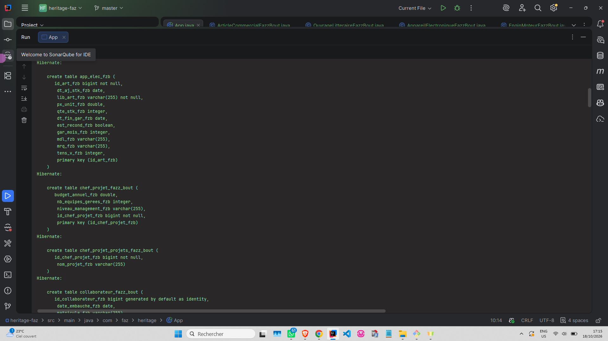
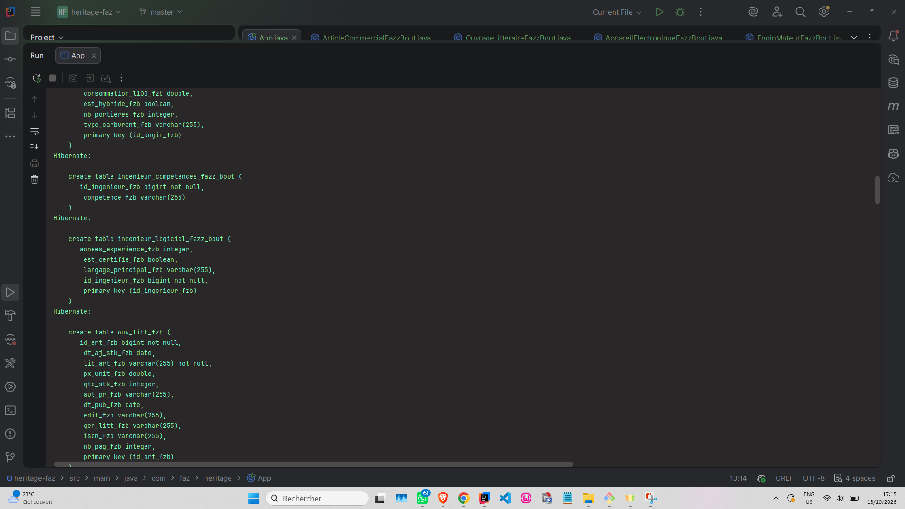
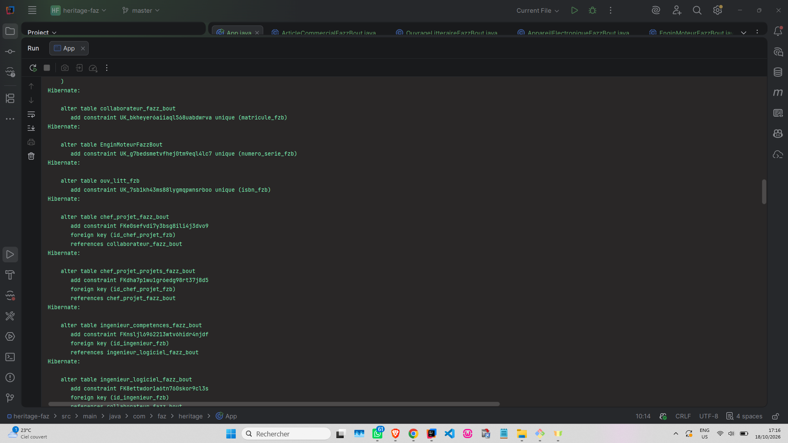
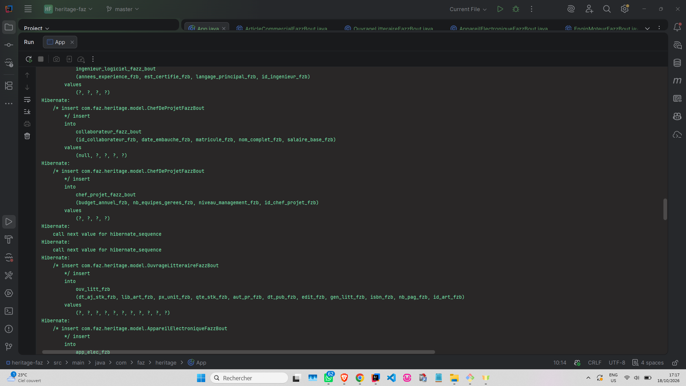
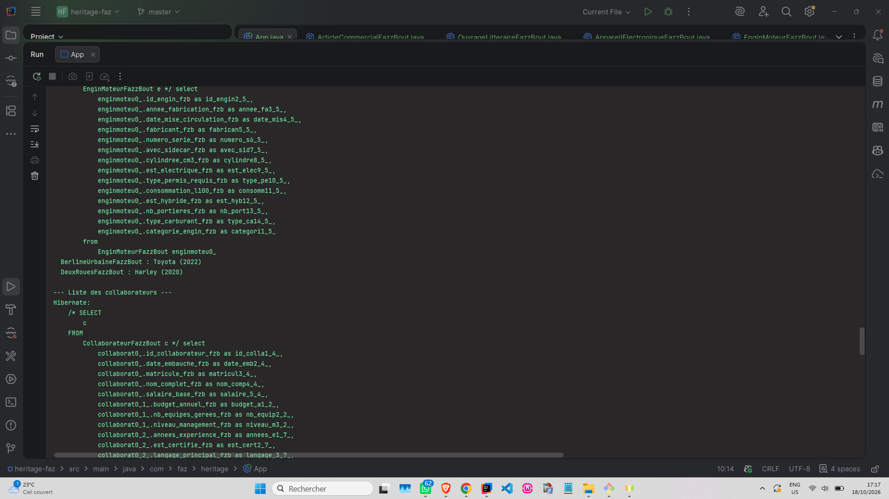
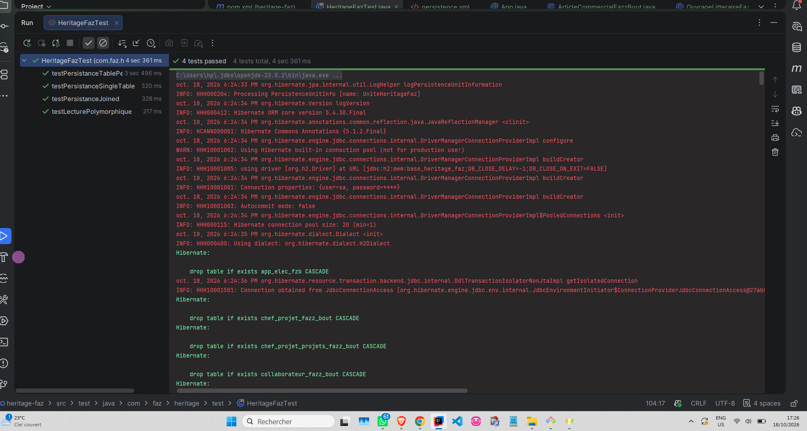

# Héritage JPA/Hibernate - Projet Heritage Faz

Projet Java JPA/Hibernate démontrant les 3 stratégies d'héritage : `SINGLE_TABLE`, `JOINED` et `TABLE_PER_CLASS`.

## 📸 Captures d'écran

### 1. Création de la table SINGLE_TABLE
*Une seule table pour toute la hiérarchie, avec une colonne discriminante.*

### 2. Création des tables JOINED
*Une table par classe (parente + filles), liées par clés étrangères.*

### 3. Création des tables TABLE_PER_CLASS
*Une table indépendante par classe concrète (colonnes dupliquées).*

### 4. Insertion des données
*Insertion des entités dans les différentes tables selon leur stratégie.*

### 5. Lecture polymorphique (SELECT)
*Récupération des entités via des requêtes JPQL polymorphiques.*

### 6. Tests unitaires JUnit
*Validation des 3 stratégies d'héritage avec 4 tests unitaires.*

